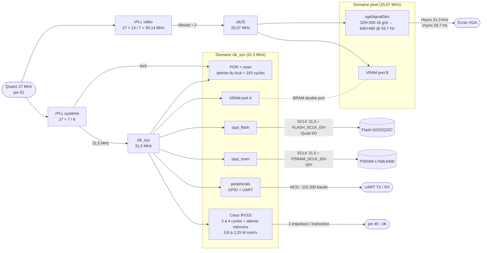

# RISC-V RV32IM sur Tang Nano 9K

Processeur **RV32IM multicycle écrit en VHDL** pour la carte Sipeed **Tang Nano 9K** (FPGA Gowin GW1NR-9). Il démarre depuis une flash QSPI externe, utilise une PSRAM QSPI externe comme RAM et se programme en C avec `riscv-none-elf-gcc`.

## Caractéristiques

- Jeu d'instructions **RV32IM**, sans CSR, interruptions ni `fence.i`. Il passe les 40 tests `rv32ui` applicables et les 8 tests `rv32um` des [riscv-tests](https://github.com/riscv-software-src/riscv-tests).
- **Extension M** : multiplication sur les multiplieurs DSP du FPGA (instruction en 5 cycles), division itérative avec sortie anticipée (7 à 35 cycles). Une multiplication 16.16 à la Doom passe de ~1 800 cycles en logiciel à 16.
- Cœur multicycle à **31,5 MHz** (rPLL), une seule horloge système, sans clock-enable : 2 cycles par instruction hors attente mémoire, 4 pour un load/store.
- Code exécuté directement depuis la **flash QSPI GigaDevice GD25Q32C** (4 Mio) : lecture Quad I/O `EBh` en mode continu, et CS# maintenu bas pendant les fetchs séquentiels.
- **Cache flash de 8 Kio** (correspondance directe, lignes de 32 octets) : une instruction déjà en cache s'exécute en 3 cycles, soit jusqu'à 10 M instructions/s.
- SCLK réglable séparément pour la flash et la PSRAM : 31,5 MHz (un nibble par cycle) ou 15,75 MHz (÷2, réglage par défaut tant que 31,5 MHz n'est pas validé sur carte). Constantes `FLASH_SCLK_DIV` et `PSRAM_SCLK_DIV` dans `top.vhd`.
- **8 Mio de RAM** : PSRAM QSPI Lyontek **LY68L6400**, en mode QPI.
- Périphériques : 32 GPIO, UART (débit programmable), timer 64 bits (cycles et microsecondes depuis le reset ; `time_us()`, `delay_ms()`… dans `periph.h`).
- **Sortie VGA en 16 niveaux de gris** : image 320×200 (4 bits par pixel) agrandie ×2, envoyée en mode standard 640×480 @ 60 Hz (centrée, 40 lignes noires en haut et en bas) sur les sorties RGB 3-3-2 via une palette de gris. Framebuffer de 32 Kio en BRAM double port, horloge pixel de 25,07 MHz produite par le rPLL. Le mode 640×400 @ 70 Hz natif reste disponible (generic `MODE_480`).
- Broche de test `clk` (pin 40) : une impulsion par instruction exécutée, pour mesurer la vitesse réelle au fréquencemètre.

## Horloges

Le quartz de 27 MHz n'alimente que les deux rPLL du GW1NR-9 :
- le rPLL système (27 × 7/6 = 31,5 MHz) cadence le cœur, le bus, les contrôleurs mémoire, les périphériques et le port cœur de la VRAM ;
- le rPLL vidéo produit l'horloge pixel.

Les deux domaines ne communiquent que par la BRAM double port de la VRAM et par le reset, resynchronisé côté pixel. Le reset système reste actif tant que le rPLL système n'est pas verrouillé.

SCLK est produit par deux bascules, l'une sur front montant et l'autre sur front descendant de `clk_sys`, combinées par un XOR (sans glitch). Il fait une impulsion par cycle : la mémoire échantillonne au milieu du cycle, et le FPGA relit sa réponse au front suivant.



## Performances

Mesures en simulation à 31,5 MHz, avec la flash à SCLK ÷2 (fils Dupont) et la PSRAM à ÷1, sur 40 ms d'exécution :

| Programme | Sans cache | Avec cache (8 Kio) | Gain |
|---|---|---|---|
| `vga_demo.c` (3,3 Kio de code) | 1,0 M instr/s | 8,95 M instr/s | ×9,0 |
| Cube 3D en flottants + `sprintf` (96 Kio de code) | 0,94 M instr/s | 7,3 M instr/s | ×7,8 |

| Accès flash | Cycles |
|---|---|
| Hit (instruction ALU complète : 3 cycles) | 2 |
| Défaut, ligne neuve | ≈ 55 |
| Mot suivant pendant le remplissage de la ligne | ≈ 21 |

Le cache garde les lignes de 32 octets déjà lues. Un défaut ne bloque le cœur que jusqu'au mot demandé : la suite de la ligne arrive en arrière-plan, en flux. Les accès à la PSRAM (pile, variables) coûtent toujours environ 25 à 30 cycles.

## Carte mémoire

| Adresse | Zone | Contenu |
|---|---|---|
| `0x0000_0000` | IO | `0x10` GPIO, `0x14` direction GPIO, `0x18` UART TX, `0x1C` UART RX, `0x20` débit UART, `0x30`/`0x34` cycles (64 bits), `0x38`/`0x3C` microsecondes (64 bits) |
| `0x4000_0000` | Flash QSPI (4 Mio) | code et constantes ; adresse de reset |
| `0x8000_0000` | PSRAM QSPI (8 Mio) | `.data`, `.bss`, pile |
| `0xC000_0000` | VRAM (32 Kio) | écran 320×200 en 16 gris : 4 bits par pixel, 40 mots de 32 bits par ligne, 8 pixels par mot, pixel de gauche dans les bits 31..28 |

Registre RX : le bit 8 vaut 1 quand un octet est disponible (bits 7:0). La lecture consomme l'octet ; sans octet disponible, la lecture rend 0.

## Arborescence

```
RISC-V/                 projet Gowin EDA (RISC-V.gprj)
  src/                  RTL VHDL (top.vhd = sommet), contraintes .cst/.sdc, IP Gowin
  tb/                   testbenches auto-vérifiants + modèles de la flash et de la PSRAM
  sim/                  scripts ModelSim (*.do)
soft/                   logiciel : start.s, link.ld, periph.c/h, comp.bat, elf2rom.py
  Flasher3.1/           programmation de la flash via un Arduino (MCU) + script Python (PC)
  tests/                programmes de test système (riscv-tests rv32ui + tests maison)
```

## Matériel

- Tang Nano 9K.
- Flash GD25Q32C et PSRAM LY68L6400 câblées sur les broches définies dans [RISC-V/src/RISC-V.cst](RISC-V/src/RISC-V.cst).
- Un Arduino avec `soft/Flasher3.1/MCU_QSPIflasher` pour écrire dans la flash. Le bit QE de la flash (Quad Enable) est activé par le flasher.
- Un adaptateur série sur `uart_tx` / `uart_rx` (115200 bauds dans les exemples). Ses niveaux doivent être compatibles avec les bancs d'IO déclarés dans le `.cst`.

## Compiler et programmer

**Bitstream** : ouvrir `RISC-V/RISC-V.gprj` dans Gowin EDA (testé avec V1.9.11.01 Education), lancer la synthèse et le placement-routage, puis charger le bitstream sur la carte.

**Logiciel** : il faut `riscv-none-elf-gcc` (par exemple xPack) dans le PATH, puis Python 3 avec `pyserial` pour le flasher.

```bat
cd soft
comp.bat main.c flash     :: compile puis programme la flash externe (port COM dans flasher.py)
comp.bat main.c rom       :: variante : génère RISC-V/src/ROM.vhd (ROM interne, voir top.vhd)
```

Au démarrage, le processeur attend environ 2 ms (initialisation de la flash et de la PSRAM), puis exécute le code à partir de `0x4000_0000`.

Le débit de l'UART est calculé à partir de `CLK_CORE_FREQ` (`soft/periph.h`, 31,5 MHz). Après un changement de fréquence système, il faut recompiler les programmes.

## Simulation

Les testbenches tournent sous **ModelSim** (testé avec ModelSim ASE en VHDL-2008). Chacun affiche une ligne `TB_RESULT: SUCCES` ou `TB_RESULT: ECHEC`.

```sh
cd RISC-V/sim
vsim -c -do "do qspi_sram.do; quit -f"      # contrôleur PSRAM + modèle LY68L6400
vsim -c -do "do qspi_flash.do; quit -f"     # contrôleur flash + modèle GD25Q32C
vsim -c -do "do peripherals.do; quit -f"    # GPIO + UART
vsim -c -do "do vga.do; quit -f"            # VGA (nécessite la bibliothèque de simulation de Gowin EDA)
vsim -c -do "do psram_model.do; quit -f"    # autotests des modèles
vsim -c -do "do flash_model.do; quit -f"

# Tests système : processeur complet + modèles mémoire, un programme par test
python ../../soft/tests/build_tests.py
vsim -c -do "do top_tests.do; quit -f"                            # 44 programmes
vsim -c -do "set TEST rv32ui-add; do top_tests.do; quit -f"       # un seul
```

Les modèles de la flash et de la PSRAM vérifient le protocole et les timings des datasheets : séquence de mise sous tension, temps de CS#, lignes non pilotées, conflits de bus, etc.

## État

- Jeu d'instructions : validé en simulation (53/53 tests système, dont rv32ui et rv32um).
- PSRAM, flash et UART (émission et réception) : validés sur carte.
- Cœur sans clock-enable et flux flash : validés sur carte (529,5 k instructions/s mesurés sur une boucle de saut à 27 MHz, comme prévu par la simulation).
- Horloge système à 31,5 MHz : validée en simulation. Avec SCLK à 31,5 MHz, les données lues sur carte étaient corrompues ; SCLK est donc à 15,75 MHz par défaut, en cours de validation.
- VGA : validé en simulation (image complète vérifiée pixel par pixel), à tester sur un écran avec `soft/vga_demo.c`.
- Cache flash : validé en simulation (TB unitaire et 44/44 tests système), à valider sur carte.
- Timing Gowin : Fmax de 33,0 MHz pour l'horloge système (31,5 MHz demandés), 108 MHz pour l'horloge pixel. BSRAM : 21/26.

## Licences

Le sous-ensemble des riscv-tests dans `soft/tests/riscv-tests/` est distribué sous sa licence BSD d'origine ([LICENSE](soft/tests/riscv-tests/LICENSE)).
